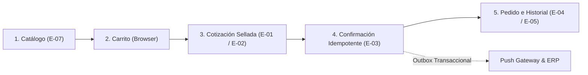
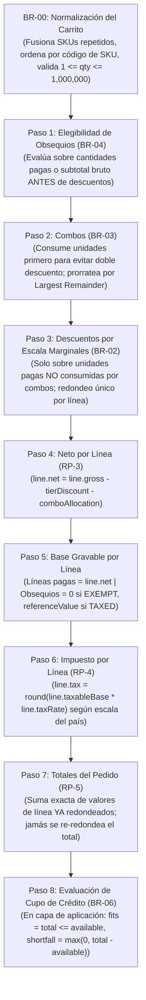
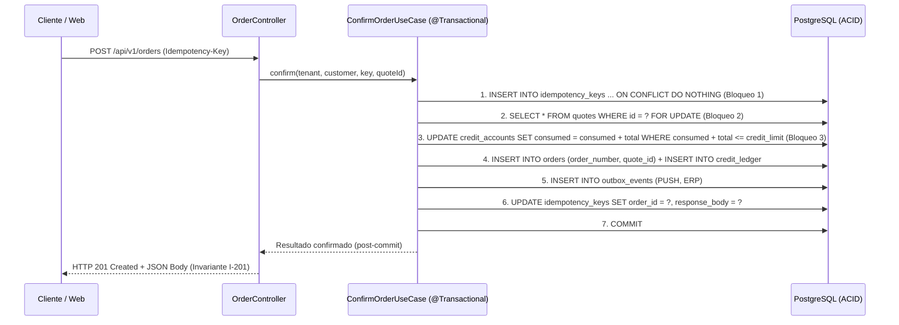

# Análisis Técnico y Auditoría Integral — Orderflow Engine

> [!NOTE]
> Este documento consolida el análisis arquitectónico, funcional y técnico completo del proyecto **Orderflow Engine** ubicado en `C:\Users\Administrador\Downloads\orderflow-engine-docs-main\orderflow-engine-docs-main`, manteniendo intacto el directorio original sin modificar ninguno de sus archivos ni artefactos generados.

---

## 1. Resumen Ejecutivo: ¿Qué es y qué hace Orderflow Engine?

**Orderflow Engine** es el sistema central de **cálculo determinista de precios (cotización)** y **confirmación atómica e idempotente de pedidos** para un marketplace B2B multi-país y multi-marca donde tenderos compran productos a distribuidores de bebidas en **Colombia (`COP`), Ecuador (`USD`), Guatemala (`GTQ`) y Perú (`PEN`)**.

El proyecto nace como solución de nivel **Tech Lead** al enunciado oficial (`assignment/Prueba_Tecnica_Tech_Lead_1.pdf`) y modela el flujo completo de compra:



### Los 4 Problemas Reales que Resuelve (`G-1` a `G-4`)

| Código | Problema del Mundo Real | Garantía del Sistema | Mecanismo Técnico |
| :--- | :--- | :--- | :--- |
| **`G-1`** | Los precios o promociones cambian mientras el tendero revisa su carrito, cobrándole un monto distinto al que vio en pantalla. | **El total cotizado es idéntico al total confirmado.** | Las cotizaciones (`quotes`, `quote_lines`, `quote_line_adjustments`) son **selladas y de solo inserción**. La tabla `orders` no guarda montos: referencia `quote_id` (`UNIQUE`), por lo que cada cifra existe una sola vez. |
| **`G-2`** | Errores de redondeo y pérdida de centavos por usar punto flotante (`float`/`double`) o mezclar monedas con distinta cantidad de decimales. | **Cero aritmética de punto flotante para dinero.** | Objeto de valor `Money(BigDecimal, CurrencyPolicy)`. La escala (`COP` = 0, `USD`/`GTQ`/`PEN` = 2) y el redondeo (`HALF_UP`) vienen de las tablas `currencies` y `countries`. El redondeo ocurre **solo por línea**. |
| **`G-3`** | En tres releases previos se devolvía número de orden (`201`) al tendero, pero el pedido no aparecía en su historial o se duplicaba al hacer doble tap. | **Un `201` significa que la orden existe, es consultable y nunca se duplica (`I-201`).** | Orden, consumo de cupo de crédito, clave de idempotencia y eventos outbox se escriben en **una sola transacción ACID en PostgreSQL**, y el `201` se serializa estrictamente después del `COMMIT`. |
| **`G-4`** | Al caer el ERP o el servidor de notificaciones Push, se pierden pedidos confirmados o se envían duplicados al reintentar. | **Los efectos externos nunca se pierden ni se aplican dos veces.** | **Transactional Outbox** escrito en la misma transacción del pedido, procesado por un relay con *lease* (`FOR UPDATE SKIP LOCKED`), *exponential backoff* y deduplicación por `event_id`. |

---

## 2. Reconocimiento, Estructura y Stack Técnico (Fase 1)

### 2.1 Mapa de la Estructura del Directorio (`orderflow-engine-docs`)
El directorio analizado corresponde al repositorio maestro de especificación y gobernanza dentro de una topología de **6 repositorios hermanos**:

```text
orderflow-engine-docs-main/
├── README.md / README.es.md                      # Mapa maestro y glosario de documentos y códigos
├── LICENSE                                       # Licencia MIT
├── .gitignore / .gitattributes                   # Reglas de integridad y finales de línea (LF/CRLF)
├── assignment/
│   └── Prueba_Tecnica_Tech_Lead_1.pdf            # Enunciado original de la prueba técnica (intocable)
├── handoff/
│   ├── HANDOFF.md                                # Estado verificado del proyecto, comandos, decisiones y trampas
│   └── progress.svg                              # Gráfica generada de avance de tareas (T-00 a T-20)
├── spec/
│   ├── constitution.md                           # 15 principios innegociables (P-01 a P-15) y su verificación
│   ├── SPEC.md                                   # Especificación funcional/no funcional, reglas BR-00..07 y ACs
│   ├── plan.md                                   # Decisiones técnicas (DEC-01..20), configuración y riesgos
│   ├── TASKS.md                                  # Plan de implementación paso a paso (T-00 a T-20)
│   ├── api-contract.md                           # Contrato HTTP/JSON detallado de las operaciones E-01 a E-07
│   ├── data-model.md                             # Modelo relacional 3NF en PostgreSQL, constraints y bloqueos
│   └── architecture.md                           # Topología hexagonal, reglas de dependencia y flujos
├── diagrams/
│   └── 01-runtime-topology.svg … 09-outbox-lifecycle.svg # 9 diagramas arquitectónicos SVG
├── governance/
│   ├── golden-rule.md                            # Regla de oro del flujo de ramas y PRs
│   ├── branches-and-environments.md              # Estrategia de ramas (main / dev / task branches)
│   ├── commit-conventions.md                     # Convenciones Conventional Commits + tag (T-NN)
│   ├── pull-request-rules.md                     # Reglas de PR, verificación y squash-merge
│   ├── documentation-rules.md                    # Reglas de indexación, pares bilingües y límites
│   ├── repository-integrity.md                   # Reglas de Docker, .env.example y prevención de secretos
│   ├── docs-governance.json                      # Configuración declarativa del verificador check-docs.mjs
│   └── templates/                                # Plantillas base para ADRs y documentos
└── deliverables/
    ├── manifest.json                             # Hashes SHA-256 de trazabilidad del ADR generado
    └── adr/
        └── 0001-order-pricing-and-confirmation(.es).{docx,pdf} # ADR-0001 de 1 página en inglés y español
```

### 2.2 Topología de los 6 Repositorios del Ecosistema (`SPEC.md §15`)

| Repositorio | Rol en la Arquitectura | Stack Principal |
| :--- | :--- | :--- |
| **`orderflow-engine-api`** | **El entregable principal.** Motor de precios, cotizaciones selladas, confirmación idempotente, historial, outbox relay, housekeeping, README y ADR-0001. | Java 21, Spring Boot (Servlet), `JdbcClient`, Liquibase, PostgreSQL 17, JUnit 5, Testcontainers, ArchUnit, JaCoCo, PIT. |
| **`orderflow-engine-web`** | **El plus opcional de frontend extendido.** Flujo completo (`carrito → cotización → confirmación → orden → Mis pedidos`) con selector de tienda e i18n. | Angular (Standalone), `@ngx-translate/core`, Vitest + Playwright (Chromium headless), Nginx (reverse proxy `/api/`). |
| **`orderflow-engine-infra`** | Orquestación del stack completo (`db + api + web`) y script unificado `test-all`. | Docker Compose, Bash (`test-all.sh`), PowerShell (`test-all.ps1`). |
| **`orderflow-engine-docs`** | Especificación viva, contrato de API, modelo de datos, diagramas SVG, gobernanza y entregables Word/PDF. | Markdown + YAML Frontmatter, SVG, JSON. |
| **`orderflow-engine-tools`** | Generadores y verificadores automáticos (`check-docs`, `check-integrity`, diagramas, gráfica de progreso y renderizado Word/PDF). | Node.js 24 (`.mjs` sin dependencias externas) y Python 3.11 (`python-docx`, `pypdf`, LibreOffice). |
| **`orderflow-engine-app`** | Carpeta reservada para una futura app móvil (no construida en esta entrega). | Documentación bilingüe y archivos de integridad. |

---

## 3. ¿Cómo Funciona Internamente? (Análisis de Flujos y Algoritmos)

### 3.1 El Motor de Precios Puro y el Orden de las Palancas (`BR-00` a `BR-05`)
Definido en `spec/SPEC.md §3` y `spec/architecture.md §3.1`, el motor es una función matemática pura `price(cart, snapshot) -> breakdown` que ejecuta **8 pasos en orden estricto**:



#### ¿Por qué este orden es el único correcto?
1. **Obsequios primero (sobre bruto):** Un obsequio premia lo que el cliente compra y agrega unidades gratis (`unitPrice = 0`), sin alterar el precio de los productos pagos.
2. **Combos antes que escalas:** Un combo es un precio especial negociado por paquete. Si las escalas se evaluaran antes o sobre las mismas unidades, el cliente recibiría **doble descuento (*double dipping*)** sobre los mismos productos.
3. **Descuentos comerciales antes de impuestos:** La ley tributaria exige calcular el IVA sobre el valor real de venta (base gravable neta tras descuentos comerciales).
4. **Redondeo por línea y nunca en el total (`RP-1`…`RP-5`):** En facturación electrónica cada línea lleva su propio impuesto redondeado. Si el total del pedido se volviera a redondear al final, la suma de las líneas de la factura no cuadraría con el total a pagar.

---

### 3.2 Los 6 Golden Tests Obligatorios (`GT-01` a `GT-06`)

| ID | Caso de Prueba | Qué demuestra y cómo se calcula |
| :--- | :--- | :--- |
| **`GT-01`** | **Descuento por escala en dos tramos marginales** (`SPEC.md BR-02`) | Tenant `co-alpha` (`COP`, escala 0, `HALF_UP`). 25 uds de `BEV-COLA-350` a `$2,500` (IVA 19%). Tramos: `1–9 -> 0%`, `10–19 -> 5%`, `20+ -> 10%`.<br>• Bruto: $25 \times 2,500 = \$62,500$<br>• Tramo 10–19 (10 uds): $10 \times 2,500 \times 5\% = \$1,250$<br>• Tramo 20–25 (6 uds): $6 \times 2,500 \times 10\% = \$1,500$<br>• Descuento `TIER`: $\$2,750$ \| Neto/Base gravable: $\$59,750$<br>• IVA 19%: $59,750 \times 0.19 = 11,352.50 \xrightarrow{\text{HALF\_UP}} \$11,353$<br>• **Total: $\$71,103$**. |
| **`GT-02`** | **Combo sin descuento suelto** (`SPEC.md §11`) | Incluso habiendo una regla de escala (`TIER`) activa sobre los SKUs del combo, las unidades consumidas por el combo producen **una única entrada `COMBO:<id>`** y **cero entradas `TIER:*`**. |
| **`GT-03`** | **Pedido con obsequio** (`SPEC.md §11`) | El producto gratis aparece en su propia línea con `isGift: true`, su cantidad y `origin: GIFT:<id>`, sin mezclarse con líneas pagas del mismo SKU. |
| **`GT-04`** | **Combo con impuestos y prorrateo por Mayor Resto** (`SPEC.md BR-03`) | Combo `{2 Colas (19% IVA) + 1 Chips (5% IVA)}` a `$5,000`. Carrito: 4 Colas (`$10,000`) + 2 Chips (`$3,600`) = `$13,600` bruto (2 aplicaciones del combo = `$10,000`, descuento combo = `$3,600`).<br>• Cuota exacta Cola: $3,600 \times \frac{10,000}{13,600} = 2,647.0588...$<br>• Cuota exacta Chips: $3,600 \times \frac{3,600}{13,600} = 952.9411...$<br>• Por *Largest Remainder*: Cola recibe `$2,647` y Chips recibe `$953` (suma exacta `$3,600`).<br>• Base gravable: Cola `$7,353` (IVA 19% = `$1,397`), Chips `$2,647` (IVA 5% = `$132`).<br>• **Total: $\$10,000 + \$1,529 = \$11,529$**. |
| **`GT-05`** | **Pedido a crédito que excede el cupo** (`SPEC.md §11`) | En cotización devuelve `credit: { fits: false, available, shortfall }` (`GoldenQuoteTest`). Si se intenta confirmar (`POST /orders`), responde `409 CREDIT_LIMIT_EXCEEDED` sin crear orden ni tocar el cupo (`CreditLimitIT`). |
| **`GT-06`** | **Regresión de cotización a confirmación** (`SPEC.md §11`) | Se cotiza un carrito en $T_1$; en $T_2$ cambia un precio en el catálogo y se desactiva una palanca; en $T_3$ se confirma la cotización de $T_1$. El total confirmado coincide **exactamente** con el de $T_1$, mientras que una nueva cotización en $T_3$ da un total distinto (`QuoteConfirmRegressionIT`). |

---

### 3.3 Confirmación Atómica, Bloqueos e Idempotencia (`SPEC §7`, `data-model §8`)

Para hacer **imposible** que un pedido devuelva `201` y luego desaparezca, `ConfirmOrderUseCase` ejecuta una sola transacción `READ COMMITTED` en PostgreSQL (`diagrams/07-confirm-transaction.svg`):



---

## 4. Diagnóstico y Recorrido de las Fases del Plan (`T-00` a `T-20`)

Según el registro verificado en `handoff/HANDOFF.md §3–§4` y `spec/TASKS.md`:

| Fase | Tareas | Qué construye y verifica cada etapa |
| :--- | :--- | :--- |
| **Fase 1: Preparación y Scaffold** | `T-00`, `T-01` | Especificación completa, gobernanza (`check-docs.mjs`, `check-integrity.mjs`), diagramas SVG, ADR-0001 en Word/PDF, scaffold de Spring Boot + PostgreSQL + Liquibase + Testcontainers + ArchUnit (`DomainPurityArchTest`, `HealthIT`). |
| **Fase 2: Dominio Puro de Precios** | `T-02` a `T-07` | `Money`, `CurrencyPolicy`, `CartNormalizer`, `PricingEngine`, escalas marginales (`TierDiscountStep`), combos y *Largest Remainder* (`ComboStep`), obsequios y políticas tributarias (`GiftStep`), y los Golden Tests `GT-01` a `GT-04`. |
| **Fase 3: Persistencia, Errores y Cotización** | `T-08` a `T-10`, `T-18`, `T-19`, `T-20` | Esquema relacional 3NF en Liquibase con rollbacks (`LiquibaseRollbackIT`), seeds de Colombia, Ecuador, Guatemala y Perú, errores RFC 9457 `problem+json` bilingües (`es`/`en`), endpoints de cotización sellada (`E-01`, `E-02`), catálogo (`E-07`), límite de cantidad `1,000,000` y `GT-05`. |
| **Fase 4: Confirmación, Historial y Outbox** | `T-11` a `T-16` | Confirmación atómica (`E-03`), pruebas de concurrencia e inyección de fallos (`GT-06`, `ConfirmOrderConcurrencyIT`, `ConfirmOrderFailureInjectionIT`), historial *read-your-writes* (`E-04`, `E-05`), `OutboxRelay` con lease y backoff, `HousekeepingJob` de retención, cobertura JaCoCo (`99.2%`) y mutación PIT (`100%`, 185/185 mutantes detectados). |
| **Fase 5: Cliente Web Angular y E2E** | `T-17`, `T-19`, `T-20` | Aplicación Angular standalone con componentes preventivos (`ui-text`, `ui-action-bar`, `ui-product-image`, `ui-problem-notice`), flujo completo sin cálculos monetarios en el navegador, proxy Nginx sin CORS, 209 tests en Chromium headless y prueba E2E con Playwright contra el stack completo en Docker. |

---

## 5. Los 10 Temas Nuevos y Patrones Avanzados de Ingeniería en este Proyecto

1. **Desarrollo Guiado por Especificación con Trazabilidad Criptográfica y por Códigos (*Spec-Driven Development*):**
   Cada principio (`P-01`…`P-15`), garantía (`G-1`…`G-4`), regla de negocio (`BR-00`…`BR-07`), punto de redondeo (`RP-1`…`RP-5`), decisión (`DEC-01`…`DEC-20`), riesgo (`RISK-01`…`RISK-07`), trampa (`TR-01`…`TR-15`) y criterio de aceptación (`AC-01`…`AC-53`) tiene un identificador único y apunta al test automatizado que lo demuestra (`README.es.md`).
2. **Gobernanza Documental Automatizada (`check-docs.mjs` + `docs-governance.json`):**
   Las reglas de documentación no son sugerencias manuales: un verificador valida que no existan archivos Markdown huérfanos, que cada documento de entrega tenga su par en inglés y español con el mismo número de encabezados, que el ADR no supere 500 palabras (1 página A4 en Arial 12) y que los archivos `.docx`/`.pdf` en `deliverables/adr/` coincidan con el hash `SHA-256` del Markdown fuente registrado en `deliverables/manifest.json`.
3. **Trampa de `java.util.Currency` con el Peso Colombiano (`TR-01`):**
   El JDK de Java reporta que `COP` tiene 2 decimales, cuando en la operación comercial colombiana se opera con escala `0`. Por ello el sistema prohíbe consultar `java.util.Currency` y lee la escala desde la tabla `currencies` y la política de redondeo desde `countries` (`handoff/HANDOFF.md TR-01`).
4. **Algoritmo *Largest Remainder* para Prorrateo Tributario de Combos (`BR-03`):**
   Resuelve el problema clásico de contabilidad donde repartir un descuento de paquete entre productos con distintas tasas de IVA pierde o gana centavos por redondeo. Trunca cada cuota a la escala de la moneda y reparte las unidades mínimas residuales a los mayores restos fraccionarios, garantizando suma exacta al centavo (`spec/SPEC.md BR-03`).
5. **Cotización Sellada Insert-Only y Orden sin Columnas de Dinero (`DEC-07`, `DM-02`, `DM-03`):**
   Eliminar las columnas de montos en la tabla `orders` y prohibir `UPDATE` en `quotes` hace que la igualdad $\text{Total Confirmado} = \text{Total Cotizado}$ sea una propiedad estructural del esquema de base de datos, no una validación frágil en código (`spec/data-model.md §4`).
6. **Claves Compuestas Multi-Tenant `(tenant_id, id)` con `UUIDv7` (`DEC-19`):**
   Combina `UUIDv7` (ordenable temporalmente, evitando la fragmentación en índices B-Tree de PostgreSQL) con llaves foráneas compuestas que incluyen siempre `tenant_id`, impidiendo fugas de datos entre países/marcas y dejando las tablas listas para particionamiento nativo (`spec/data-model.md §7 y §9`).
7. **SQL Explícito con `JdbcClient` y Orden Fijo de Bloqueos Pesimistas (`DEC-05`, `SPEC §7.1`):**
   Se descarta JPA/Hibernate para controlar el orden exacto de bloqueos (`idempotency_keys` $\rightarrow$ `quotes FOR UPDATE` $\rightarrow$ `credit_accounts UPDATE condicional`), eliminando tanto condiciones de carrera como interbloqueos (*deadlocks*).
8. **Outbox Transaccional con Lease (`FOR UPDATE SKIP LOCKED`) fuera de Transacción (`DEC-09`, `RF-8`):**
   Separa la reclamación del evento (transacción corta que asigna `locked_until`) del envío HTTP/RPC hacia Push/ERP (sin transacción abierta), evitando agotar el pool de conexiones de PostgreSQL si un sistema externo tarda en responder.
9. **Verificación de Calidad de Pruebas mediante Mutation Testing (`PIT`) y `ArchUnit` (`DEC-14`):**
   Además del gate de cobertura JaCoCo ($\ge 90\%$), **PIT** muta el código del motor de precios para comprobar que los tests realmente fallen ante cualquier cambio lógico (logrando **100% de mutaciones detectadas: 185/185**), mientras **ArchUnit** protege la pureza hexagonal y las fronteras de `@Transactional`.
10. **Arquitectura Frontend de Origen Único (Cero CORS), Cero Aritmética Monetaria y Componentes Preventivos (`SPEC §10`):**
    El contenedor Nginx sirve Angular y redirige `/api/` al backend bajo el mismo origen (`TR-09`), el cliente formatea los strings monetarios directamente con `Intl.NumberFormat` usando `es-419`/`en` sin pasarlos a `Number` (`OD-05`), y los componentes `<ui-text>`, `<ui-action-bar>` y `<ui-product-image>` se prueban en **Chromium headless real** (no `jsdom`, `TR-11`) para garantizar cero textos cortados, cero controles tapados por el teclado y proporción uniforme de imágenes.
